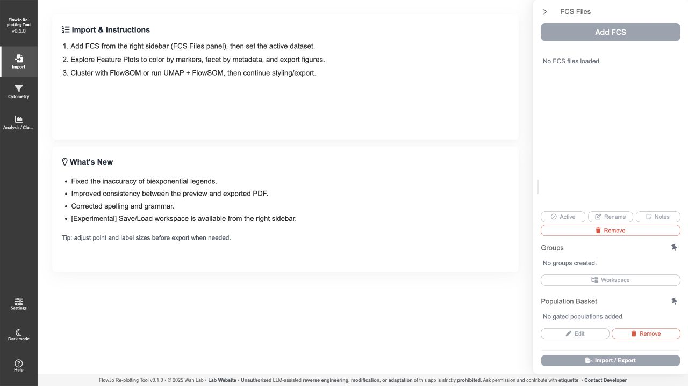

# FlowJo Clustering

R Shiny application for importing FlowJo workspaces and FCS cytometry files, reviewing gates, preparing analysis populations, and generating plots. The interface identifies the application as **FlowJo Re-plotting Tool v0.1.0**.



## Workflow

1. Add FCS files in the right sidebar, or import a FlowJo workspace with its corresponding FCS files.
2. Review compensation, gate geometry and populations before analysis.
3. Add populations to the Population Basket and review the inputs used to create an Analysis Object.
4. Create named analysis runs with UMAP and/or FlowSOM.
5. Review feature plots and export plots or selected populations. Save workspaces for later recovery.

FlowJo workspace imports depend on the source files and transformations. Review imported gates against the original workspace before interpreting population counts.

## Run from source

Install R 4.4.3. Internet access is needed for the first dependency installation; compiled packages may require platform build tools and system libraries.

```sh
git clone https://github.com/Pinhki/FlowJo-Clustering.git
cd FlowJo-Clustering
mkdir -p package_libraries python_envs
```

On macOS, run `bash Launch_mac.sh` from this directory. On Windows, open `Launch_Windows.bat`. The launchers start `Contents/run.R`; do not start `Contents/app.R` directly. The bootstrap installs the core interface packages, and `Contents/global.R` checks the cytometry and plotting dependencies, including flowCore, flowWorkspace, CytoML, FlowSOM and openCyto.

The screenshot above was captured from the running local app on 2026-10-22. A clean installation on another machine and full analysis workflows have not been verified for this publication.

## Source layout

- `Contents/R/global/`: workspace import, gate handling, shared data and analysis helpers.
- `Contents/R/interface/`: Shiny pages and shared interface components.
- `Contents/www/`: browser scripts and styles.
- `scripts/`: focused checks for analysis inputs, gate exports and workspace-file resolution.

## Development history

This repository preserves the seven original code commits and the subsequent code and documentation updates. The separate agent-checkpoint branch containing conversation logs is not published. Research data and installed runtime libraries are not supplied.

## License and project status

No open-source license has been granted yet. Existing copyright and permission notices apply. Public visibility alone does not grant permission to reuse or modify this code.

This is research software under active development. No external user count, adoption claim, or independent validation is asserted here. Report reproducible problems through GitHub Issues without uploading private sample data.
