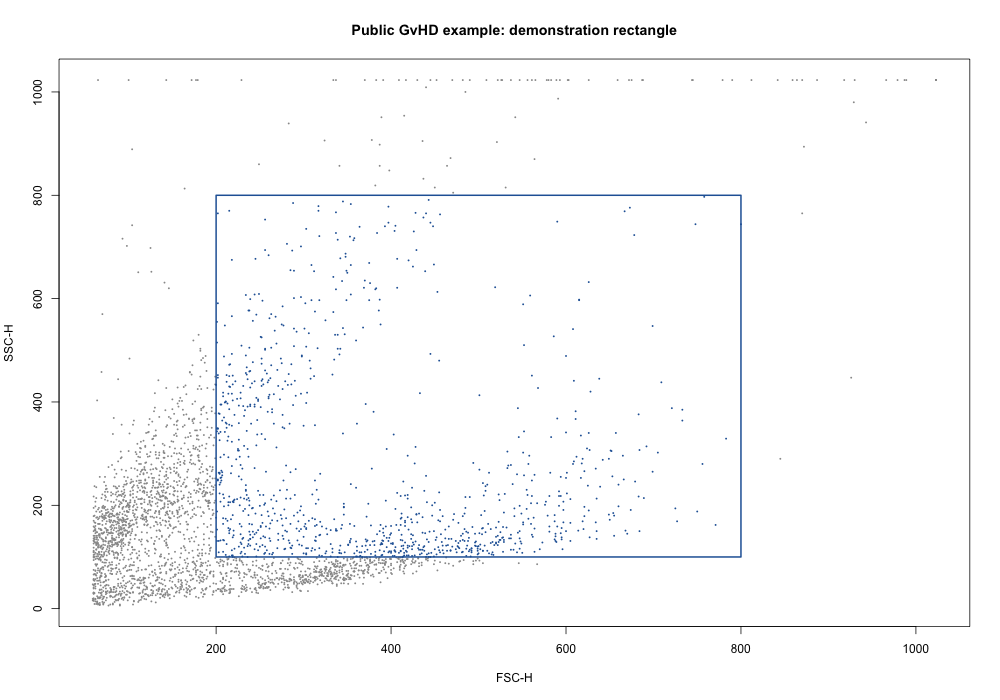

# Public cytometry example

Run from the repository root after installing the app dependencies:

```sh
Rscript --vanilla examples/public_gvhd.R example-output
```

The script uses the first flow frame in the public `GvHD` dataset distributed with flowCore. It contains 3,420 measured events in the tested flowCore 2.18.0 installation. The package documents the dataset as an extract of a graft-versus-host disease monitoring experiment; see the [flowCore manual](https://www.bioconductor.org/packages/release/bioc/manuals/flowCore/man/flowCore.pdf), dataset `GvHD`.

The assistant-defined demonstration rectangle selects events with FSC-H from 200 through 800 and SSC-H from 100 through 800, inclusive. It selects 1,006 of 3,420 events. This is a software check, not a biological gate or cell-type annotation. The script compares the app helper with a direct calculation of the same rule.

Expected final output:

```text
PASS: 3420 events; 1006 satisfy the stated rectangle.
```

The optional output directory receives an FCS file for the app's Add FCS control and a PNG plot. Generated files stay local and are ignored by Git. No data from the user's research are used.


